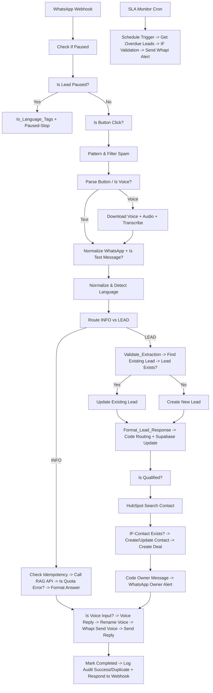

# 📱🏙️ RE-LEAD-Engine-DXB-Prod – Enterprise Dubai Real Estate WhatsApp Lead Engine

     

Production-grade WhatsApp RE-LEAD Engine — Voice + Text + Button Clicks → Bot Language Tags → Transcription → RAG → **Lead Intake, Qualification, 【entity-HubSpot¦canonical_name=HubSpot】 Sync, Owner Alert, Voice Reply & SLA Monitoring**

> Day 9/23 of 23-Day AI Sprint | SLA Monitor Cron Live | HubSpot Contact + Deal Automation | Voice Reply + Rename Voice | Paused/Spam Guard | 91.4% grounded carry-over from Day 8 | Audit Logging

---

## ✨ Features – Day 9 Upgrade (vs Day 8)

- ⏸️ **Pause & Spam Guard** – `Check If Paused` → `Is Lead Paused?` → `Parse Button` → `If-Skip Check?` → `Io_Language_Tags` → `Paused-Stop` + `Pattern & Filter Spam` – prevents duplicate processing on paused leads
- 🔘 **Button Click Router** – `Is Button Click?` branch for WhatsApp interactive buttons
- 🎙️ **Voice Pipeline** – `Is Voice?` → `Download Voice` → `Download Audio File` → `Transcribe` (Groq Whisper) → `Set Question` → `Normalize & Detect Language` – same as text path
- 🧠 **Intent Router v2** – `Route INFO vs LEAD` – INFO → RAG API | LEAD → Validation + HubSpot
- ✅ **Lead Validation & Persistence** – `Validate_Extraction` → `Find Existing Lead` (phone unique) → `Lead Exists?` → `Update Existing Lead` (merge-preserve) / `Create New Lead`
- 📊 **Deterministic Qualification** – `Is Qualified?` JS Node `bedrooms && location && budget_max>=1M` – not LLM hallucination
- 🔎 **【entity-HubSpot¦canonical_name=HubSpot】 CRM Sync – NEW Day 9** – `HubSpot-Search Contact by Phone` → `IF-Contact Exists?` → `Create or update a contact` → `Create a deal` → `Code-Owner Message` → `WhatsApp-Owner Alert with Buttons`
- 🗣️ **Voice Reply – NEW** – `Is Voice Input?` → `Voice Reply` → `Rename Voice` → `Whapi Send Voice` + `Send WhatsApp Reply`
- 🛡️ **Reliability** – `Check Idempotency` → `Already Processed?` → `Mark Processing Before Call RAG API` → `Call RAG API` → `Is Quota Error?` → `Fallback Reply` / `Format Professional Answer`
- ⏰ **SLA Monitor Cron – NEW** – `Schedule Trigger` → `Get Overdue Leads` (Supabase getAll:row) → `IF / Validation` → `Send Whapi Alert` – catches leads not contacted in SLA window
- 📊 **Full Observability** – `Mark Completed` + `Log Audit Success` / `Mark Failed` + `Log Audit Failed` / `Log Audit Duplicate` + `Respond to Webhook` → `Format_Ask_Missing`

---

## 🏗️ Architecture – Day 9

