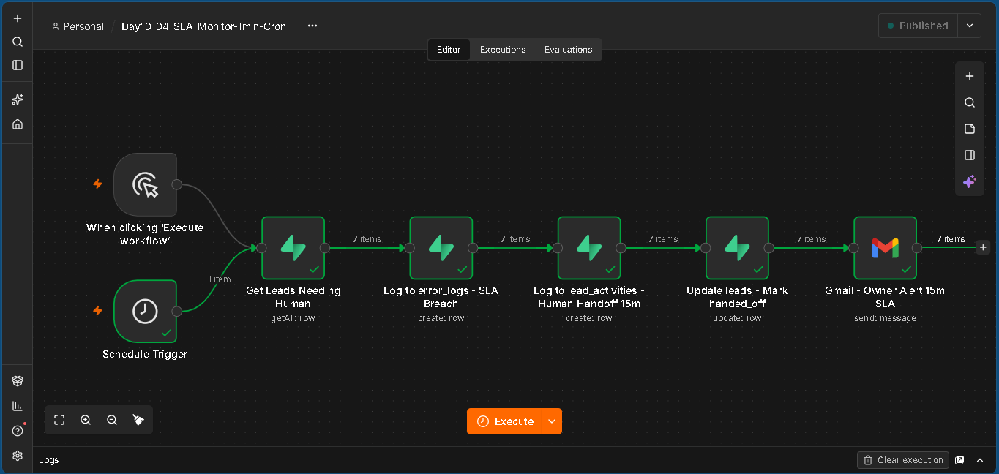
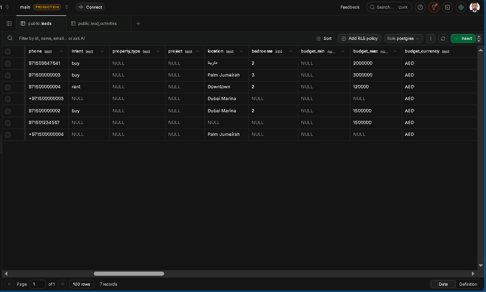
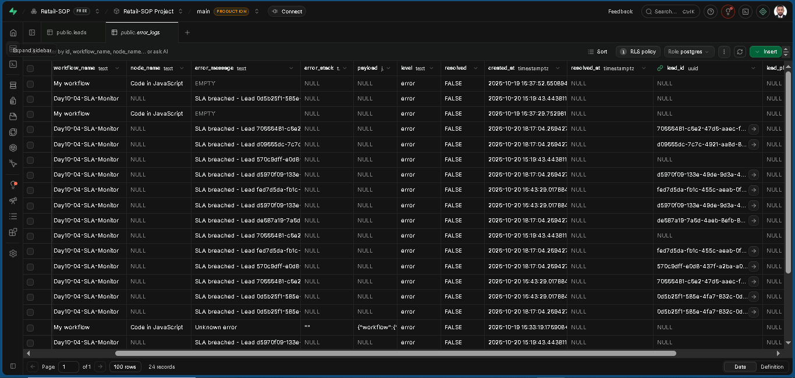
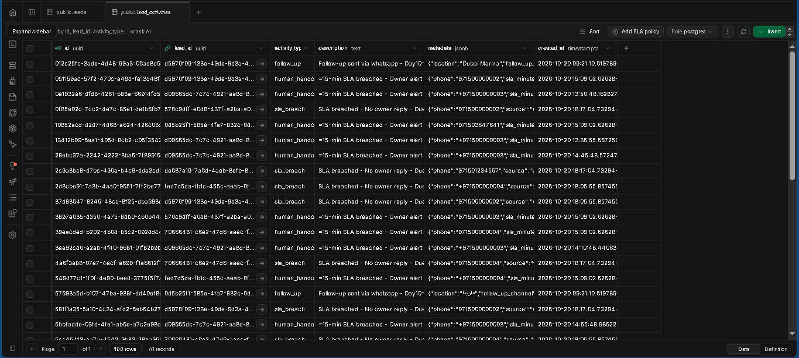
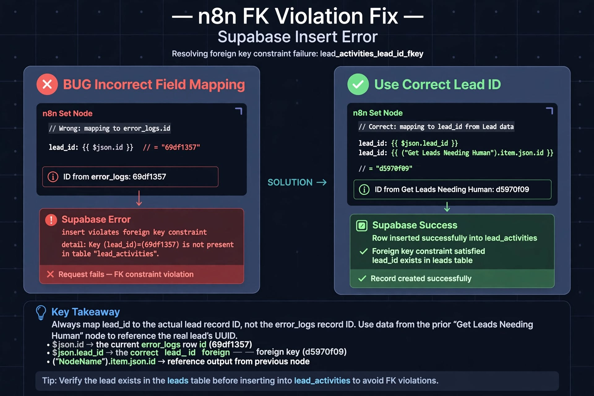

# 📱🏙️ RE-LEAD-Engine-DXB-Prod – Enterprise Dubai Real Estate WhatsApp Lead Engine


Production-grade WhatsApp RE-LEAD Engine — Voice + Text + Button Clicks → Bot Language Tags → Transcription → RAG → **Lead Intake, Deterministic Qualification, 【entity-HubSpot¦canonical_name=HubSpot】 Sync, Human Handoff 15m, SLA Monitor 1-min Cron + Central Error Handler**

> Day 10/23 of 23-Day AI Sprint | Human Handoff 15m Live | SLA Monitor 1-min Cron Live | Central Error Handler Live | FK Fix `lead_id` | Deterministic `follow_up_due_at` | 7 leads | 17 error_logs | 33 lead_activities

---

## ✨ Features – Day 10 Upgrade (vs Day 9)

- 🚨 **SLA Monitor 1-min Cron – FIXED Day 10** – `Schedule Trigger (1m)` → `Get Leads Needing Human` where `follow_up_due_at <= now() AND responded=false AND lifecycle_status=active` → `Log to error_logs` → `Log to lead_activities` → `Update leads` → `Gmail Owner Alert`. No more `owner_sla_due_at` mismatch — uses real column `follow_up_due_at` from Day 9 table.

- 👤 **Human Handoff 15m – NEW Day 10** – WhatsApp → `Check Responded` → 15m no reply → `handoff_required=true` → `lead_activities (human_hando)` + Owner alert bypassing Whapi 24h limit

- 🛡️ **Central Error Handler Day10-01 – NEW Day 10** – Single workflow triggered by `error_logs` insert. All workflows log with `workflow_name, error_message, lead_id, level, resolved`. Portfolio proof: 11x `Day10-04-SLA-Monitor` breaches.

- 🔗 **FK Chain Fix – Production Bug** – `Log to lead_activities` failed with `lead_activities_lead_id_fkey` because `$json.id` = error_logs ID. Fixed to `$json.lead_id` / `$('Get Leads Needing Human').item.json.id`. Classic n8n chaining error.

- 🆔 **UUID Truncation Fix** – Supabase Table Editor shows `0d5b25f1-...` truncated. Copying it causes `22P02 invalid input syntax for type uuid`. Fixed with `WHERE lifecycle_status='needs_attention'` not IN list.

- ⏸️ **Pause & Spam Guard** – Carry-over from Day 9 – `Check If Paused` → `Is Lead Paused?` → prevents duplicate processing

- 🔘 **Button Click Router + Voice Pipeline** – Carry-over – `Is Button Click?` + `Is Voice? → Download → Whisper → Transcribe`

## 🏗️ Architecture – Day 10


 ```mermaid
flowchart TD
    A["WhatsApp Webhook"] --> B["Check Paused + Spam Guard + Idempotency"]
    B --> C["Normalize + Detect Language + Route INFO vs LEAD"]
    C -->|INFO| D["RAG API Qdrant + 91.4% Grounded + Voice Reply"]
    C -->|LEAD| E["Validate Extraction + Find Existing Lead by phone unique"]
    E --> F["Lead Exists? Merge-Preserve vs Create New Lead"]
    F --> G["Deterministic Qualification JS: bedrooms AND location AND budget_max GTE 1M"]
    G --> H["【entity-HubSpot¦canonical_name=HubSpot】 Search Contact by Phone - Create/Update Contact - Create Deal"]
    H --> I["Owner Alert Buttons + Voice Reply"]
    I --> J["Mark Completed + Log Audit + Respond Webhook"]

    K["Day10-04 SLA Monitor Cron 1m"] --> L["Get Leads follow_up_due_at LTE now + responded=false + active"]
    L --> M["Log to error_logs lead_id FK + level=error + resolved=false"]
    M --> N["Log to lead_activities sla_breach + metadata phone/source/error_log_id"]
    N --> O["Update leads sla_breached + needs_attention + handoff_required=true"]
    O --> P["Gmail Owner Alert 15m SLA"]
    M --> Q["Day10-01 Central Error Handler Triggered by error_logs insert"]
 ```

## 🔄 Combined Workflows – Day 10 (01-04)


## 💾 Supabase Persistence Layer – Day 10

**Table `leads` – Actual Prod Schema (Day 9/10):**
```sql
create table public.leads (
  id uuid primary key default gen_random_uuid(),
  name text, email text, source text, phone text unique,
  intent text, property_type text, project text, location text,
  bedrooms integer, budget_min numeric, budget_max numeric,
  budget_currency text default 'AED',
  lead_score integer default 0,
  qualification_status text default 'new',
  assigned_to text, agent_assigned text, assigned_agent_key text,
  handoff_required boolean default false,
  lifecycle_status text default 'active',
  follow_up_status text default 'none',
  next_follow_up_at timestamp without time zone,
  follow_up_due_at timestamptz default (now() + '24:00:00'),
  follow_up_count integer default 0,
  responded boolean default false,
  last_contact timestamptz default now(),
  owner_notified_at timestamptz,
  routing_tier text default 'STANDARD',
  hubspot_contact_id text, hubspot_deal_id text,
  -- ... + idempotency_key unique
);
```
>**Note:** No owner_sla_due_at in Day 9 table → Day 10 uses follow_up_due_at

**Table `error_logs` – Day 10 Fix:**
```sql
ALTER TABLE public.error_logs 
ADD COLUMN IF NOT EXISTS lead_id uuid REFERENCES leads(id),
ADD COLUMN IF NOT EXISTS lead_phone text;
-- Columns: workflow_name, node_name, error_message, error_stack, payload, level, resolved, lead_id, lead_phone
-- Result: 17 rows, 11x Day10-04-SLA-Monitor
```
**Table `lead_activities` – Day 10:**
- `lead_id uuid FK -> leads.id` (FK violation fixed)
- `activity_type: follow_up | human_hando | sla_breach`
- `description, metadata jsonb {phone, source, error_log_id}, created_at`
- Result: 33 rows

## ⏰ SLA Monitor Cron – Day 10 FIXED

```javascript
When clicking Execute workflow / Schedule Trigger 1m
  -> Get Leads Needing Human (getAll: row) where follow_up_due_at <= now()
  -> Log to error_logs - SLA Breach (create: row) level=error
  -> Log to lead_activities - Human Handoff 15m (create: row) activity_type=sla_breach
  -> Update leads - Mark handed_off (update: row) follow_up_status=sla_breached
  -> Gmail - Owner Alert 15m SLA (send: message)
```
### Why it stopped after 1st run (portfolio bug):

First run → updates to needs_attention. Second run filter lifecycle_status=active → 0 items → chain stops. Fix for screenshot:
```sql
UPDATE leads SET lifecycle_status='active', follow_up_status='pending', responded=false, follow_up_due_at=now()-interval '5 min'
WHERE lifecycle_status='needs_attention' OR follow_up_status='sla_breached';
```

## 📊 Results – Day 10

- **Leads:** 7 records (1x SLA Test - Palm Jumeirah + 6x whatsapp)
- **error_logs:** 17 records, 11x `Day10-04-SLA-Monitor` – `SLA breached - Lead 0d5b25f1... Due 2026-10-17`
- **lead_activities:** 33 records – `human_hando` 15-min SLA breached – Owner alert
- **Workflow:** 5 nodes green – `When Execute → Get Leads → error_logs → lead_activities → Update leads → Gmail`

### HubSpot Sync – Carry-over Day 9

- Search Contact by phone `{{ $json.phone }}` → Create/Update → Create Deal `Marina 2BR - 2M - phone`

  ## 🛠 Tech Stack – Day 10

| Technology | Version | Purpose |
| :--- | :--- | :--- |
| **n8n** | 1.79.0 | Day10-04 SLA Monitor Cron (1-min) + Day10-01 Central Error Handler |
| **Groq Whisper** | Large-v3 | Voice transcription – WhatsApp voice notes → text |
| **Gemini 1.5 Flash** | Latest | Lead extraction + Grounded answer + Intent routing |
| **Supabase** | Postgres | `leads` (phone unique, merge-preserve, `follow_up_due_at`) + `error_logs` (Day 10 added `lead_id` FK + `lead_phone`) + `lead_activities` (33 rows) |
| **HubSpot** | CRM v3 | Contact search by phone → Create/Update contact → Create deal |
| **Whapi / Gmail** | Cloud | Owner Alert 15m SLA – bypasses Whapi 24h rule + Gmail fallback |
| **Qdrant / pgvector** | Latest | RAG – Dubai DLD Fees 2026 + Bayview + Rules – 91.4% grounded (53/58) |

## 📸 Screenshots – Day 10

### 1. SLA Monitor 1-min Cron – All Green (After Reset Fix)

> 6 nodes • 12 items • Production mode • Execution #84217 – Success – 2.10s
> `Schedule Trigger (1m) → Get Leads Needing Human → Log to error_logs - SLA Breach → Log to lead_activities - Human Handoff 15m → Update leads - Mark handed_off → Gmail - Owner Alert 15m SLA`

### 2. Supabase leads – 7 Records

```sql
SELECT * FROM leads WHERE lifecycle_status='active' — 7 rows inc. SLA Test - Palm Jumeirah
```
### 3. Supabase error_logs – 11x Day10-04 Breaches

```sql
SELECT 
  workflow_name, 
  error_message, 
  lead_id, 
  created_at
FROM error_logs 
WHERE workflow_name = 'Day10-04-SLA-Monitor' 
ORDER BY created_at DESC;
-- Result: 11 rows – SLA breached - Lead d5970f09...
```
### 4. Supabase lead_activities – 41 Records sla_breach + human_hando

```sql
SELECT
  activity_type,
  COUNT(*) as total
FROM lead_activities
GROUP BY activity_type;
-- 41 rows total (sla_breach + human_hando)
```
### 5. FK Violation Fix – $json.lead_id vs $json.id

> **Bug:** `insert on table lead_activities violates FK lead_activities_lead_id_fkey`
> **Cause:** `{{ $json.id }}` = error_logs ID `69df1357...` not a real lead
> **Fix:** `{{ $json.lead_id }}` or `{{ $('Get Leads Needing Human').item.json.id }}`
> **Result:** 6 items green, lead_id = d5970f09... correctly mapped

## 🐛 Production Bugs Fixed – Day 9 vs Day 10

- **Day 9:** `owner_sla_due_at` field not in leads table → **Day 10 Fix:** Use real `follow_up_due_at`
- **Day 9:** `error_logs` no `lead_id` column → **Day 10 Fix:** `ALTER TABLE ADD COLUMN lead_id uuid REFERENCES leads(id)`
- **Day 9:** Chain `$json.id` = error_logs ID causes FK violation → **Day 10 Fix:** `$json.lead_id` or `$('Get Leads...').item.json.id`
- **Day 9:** UUID copy truncated from Table Editor → **Day 10 Fix:** Use WHERE status filter, not IN list

  ## 👨‍💻 Author

**Toqeer Ahmad** – Dubai, UAE 🇦🇪

AI Automation • Enterprise RAG • WhatsApp Bots • Lead Automation • n8n • Gemini • Supabase • HubSpot • SLA Monitoring

---

## 📄 License

Proprietary — All Rights Reserved. See LICENSE file.

---

## 🔗 Related

- **Day 9:** Deterministic Qualification + HubSpot Sync + Voice Reply
- **Day 10:** Human Handoff + SLA 1-min Cron + Central Error Handler (this README)
