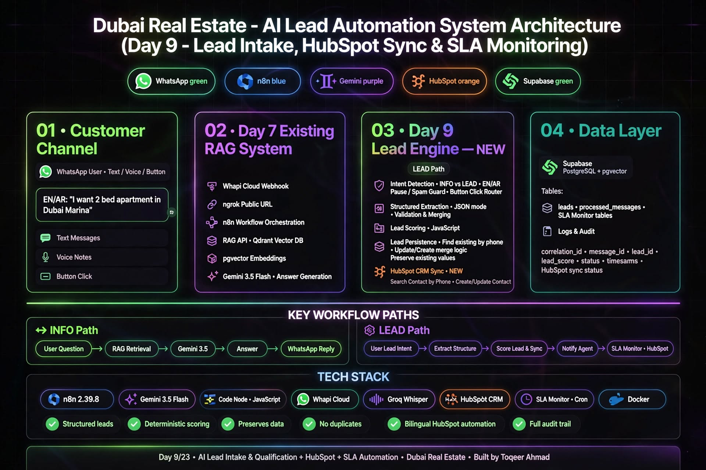
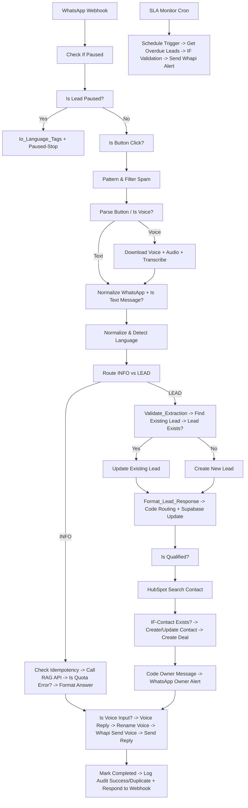
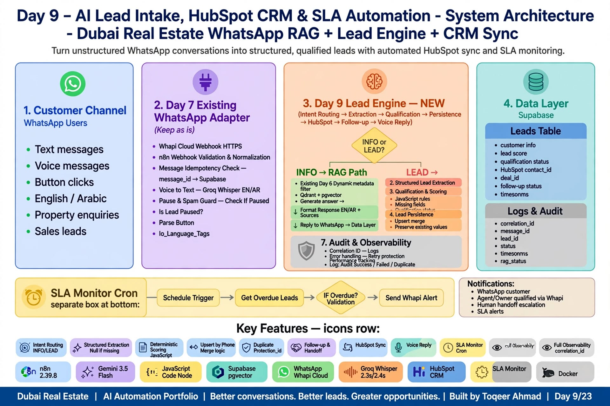
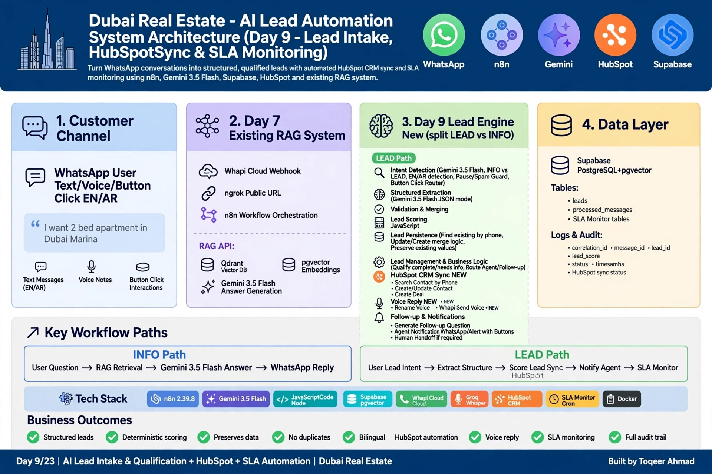
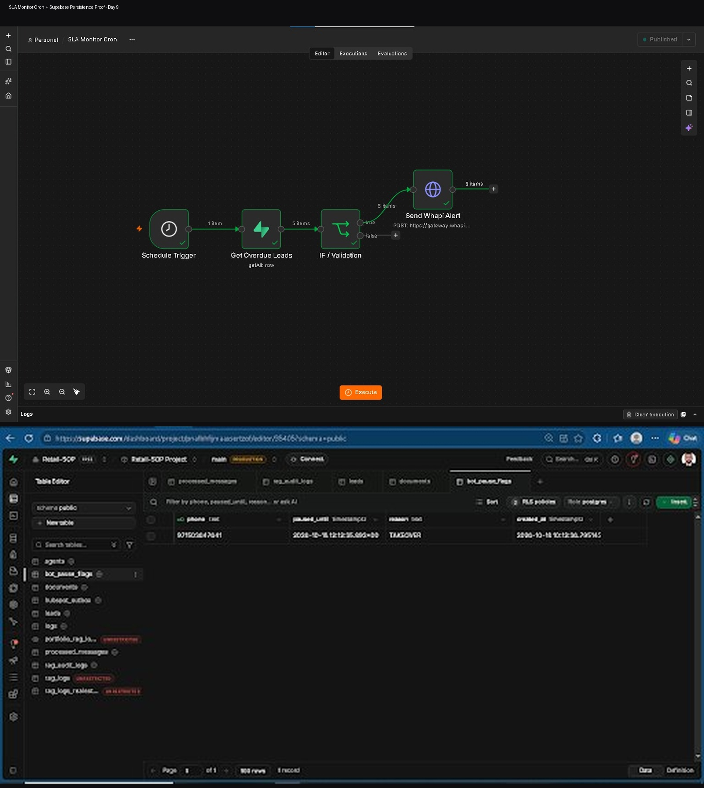
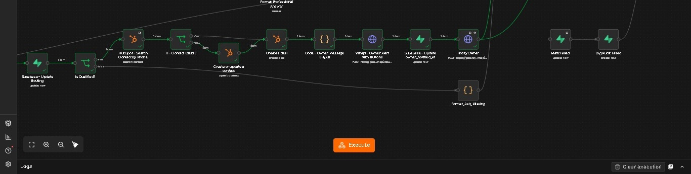

# 📱🏙️ RE-LEAD-Engine-DXB-Prod – Enterprise Dubai Real Estate WhatsApp Lead Engine


-success)


Production-grade WhatsApp RE-LEAD Engine — Voice + Text + Button Clicks → Bot Language Tags → Transcription → RAG → **Lead Intake, Qualification, HubSpot Sync, Owner Alert, Voice Reply & SLA Monitoring**

> Day 9/23 of 23-Day AI Sprint | SLA Monitor Cron Live | HubSpot Contact + Deal Automation | Voice Reply + Rename Voice | Paused/Spam Guard | 91.4% grounded carry-over from Day 8 | Audit Logging

---

## ✨ Features – Day 9 Upgrade (vs Day 8)

- ⏸️ **Pause & Spam Guard** – `Check If Paused` → `Is Lead Paused?` → `Parse Button` → `If-Skip Check?` → `Io_Language_Tags` → `Paused-Stop` + `Pattern & Filter Spam` – prevents duplicate processing on paused leads
- 🔘 **Button Click Router** – `Is Button Click?` branch for WhatsApp interactive buttons
- 🎙️ **Voice Pipeline** – `Is Voice?` → `Download Voice` → `Download Audio File` → `Transcribe` (Groq Whisper) → `Set Question` → `Normalize & Detect Language` – same as text path
- 🧠 **Intent Router v2** – `Route INFO vs LEAD` – INFO → RAG API | LEAD → Validation + HubSpot
- ✅ **Lead Validation & Persistence** – `Validate_Extraction` → `Find Existing Lead` (phone unique) → `Lead Exists?` → `Update Existing Lead` (merge-preserve) / `Create New Lead`
- 📊 **Deterministic Qualification** – `Is Qualified?` JS Node `bedrooms && location && budget_max>=1M` – not LLM hallucination
- 🔎 **【entity-HubSpot¦canonical_name=HubSpot】 CRM Sync – NEW Day 9** – `HubSpot-Search Contact by Phone` → `IF-Contact Exists?` → `Create or update a contact` → `Create a deal` → `Code-Owner Message` → `WhatsApp-Owner Alert with Buttons`
- 🗣️ **Voice Reply – NEW** – `Is Voice Input?` → `Voice Reply` → `Rename Voice` → `Whapi Send Voice` + `Send WhatsApp Reply`
- 🛡️ **Reliability** – `Check Idempotency` → `Already Processed?` → `Mark Processing Before Call RAG API` → `Call RAG API` → `Is Quota Error?` → `Fallback Reply` / `Format Professional Answer`
- ⏰ **SLA Monitor Cron – NEW** – `Schedule Trigger` → `Get Overdue Leads` (Supabase getAll:row) → `IF / Validation` → `Send Whapi Alert` – catches leads not contacted in SLA window
- 📊 **Full Observability** – `Mark Completed` + `Log Audit Success` / `Mark Failed` + `Log Audit Failed` / `Log Audit Duplicate` + `Respond to Webhook` → `Format_Ask_Missing`

---

## 🏗️ Architecture – Day 9





## 💾 Supabase Persistence Layer – Day 9
**Table `leads` (from your screenshot 874356278431):**
- `phone` (unique conflict key) - used in Find Existing Lead by `phone || webhook_phone`
- `status` - new | qualified | contacted | overdue
- `details` jsonb {budget_max, bedrooms, location, timeline, requirements, hubspot_contact_id, deal_id}
- `created_at`, `updated_at` - timestamptz
**Table `rag_audit_logs` – real schema 11 cols (NOT top_doc_title):**
- `id`, `message_id`, `phone`, `question`, `answer`, `language`, `source`, `latency_ms`, `rag_status` (grounded/fallback), `correlation_id`, `created_at`
**Table `processed_messages`:**
- `message_id` unique - idempotency guard
**Merge Preserve Logic – Critical Fix:**
```js
// Update Existing Lead – Day 9 – preserves previous values
{
  phone: existing.phone,
  location: new.location || existing.location,
  bedrooms: new.bedrooms ?? existing.bedrooms,
  budget_max: new.budget_max ?? existing.budget_max,
  timeline: new.timeline || existing.timeline,
  hubspot_contact_id: existing.hubspot_contact_id
}
// Tested: Q1 "2BR Marina 2M" -> Q2 "still interested" (missing fields) -> preserves 2M
```

## ⏰ SLA Monitor Cron – Day 9 NEW

### SLA Monitor Cron:

```text
Schedule Trigger (Cron every 15min)
  -> Get Overdue Leads (getAll: row from Supabase)
  -> IF / Validation (true = overdue exists, false = none)
  -> Send Whapi Alert (POST https://gateway.whapi.cloud/send)
```
### SQL for overdue:

```sql
SELECT phone, details, status, updated_at 
FROM leads 
WHERE status = 'new' 
AND updated_at < NOW() - INTERVAL '15 minutes' 
LIMIT 5;
```
> " Business Value: No lead goes cold - auto alert owner if not contacted in SLA window."

## 📊 Results – Day 9
### RAG Evaluation – Carry-over 91.4% (53/58 grounded)
```SQL
SELECT 53 as grounded, 5 as fallback, 91.4 as grounded_rate;
```

### HubSpot Sync – Day 9 NEW

- Search Contact by phone: `{{$json.hubspot}}-contacts-v3 search`
- IF exists -> update, else create
- Create deal with dealname: `Marina 2BR - 2M - phone`
- **Owner alert with buttons:**
    - 📞 `Call Lead`
    - 🔗 `View in HubSpot`

### Whapi Button Payload:
 
```javascript
{
  "to": "{{ $json.owner_phone }}",
  "type": "buttons",
  "body": "🔥 New Qualified Lead: {{ $json.name }} | {{ $json.bedrooms }}BR {{ $json.location }} | AED {{ $json.budget_max }}",
  "buttons": [
    { "id": "call_lead", "title": "📞 Call Lead" },
    { "id": "view_crm", "title": "🔗 View in CRM" }
  ]
}
```


## 🗣️ Voice Reply – Day 9 NEW
- `Is Voice Input?` true -> `Voice Reply API` -> `Rename Voice` -> `Whapi Send Voice`
- Same professional answer but as voice note for voice users

## 🛠 Tech Stack – Day 9
| Technology ↕️ | Version ↕️ | Purpose ↕️ |
|------------|---------|---------|
| **n8n** | 2.39.8 | Workflow orchestration – RE-LEAD-Engine-DXB-Prod + SLA Monitor Cron |
| **Groq Whisper** | Large-v3 | Voice transcription – WhatsApp voice notes 0:02 → text 2.3s EN / 2.4s AR |
| **Gemini 3.5 Flash** | Latest | Lead extraction + Grounded answer generation – Fixed from 2.5 Flash in Day 7 |
| **Qdrant / Supabase pgvector** | Latest | Vector DB – Dubai DLD Fees 2026 + Bayview + Damac Hills 2 + Rules – Dynamic filter |
| **Supabase** | Postgres | leads (phone unique, merge-preserve) + rag_audit_logs (11 cols) + processed_messages |
| **HubSpot** | CRM v3 | NEW – Contact + Deal automation |
| **Whapi Cloud** | Latest | WhatsApp gateway – text, voice, buttons |
| **SLA Monitor** | Cron | NEW – Overdue lead alert |
| **Docker** | 4.95.0 | Self-hosted n8n + RAG API |

## 📸 Screenshots – Day 9
### 1. Architecture Day 9 – HubSpot Sync + SLA Monitor + Voice Reply (Main – Gemini 3.5 Flash)


### 2. Detailed Workflow – Intent Routing -> Extraction -> HubSpot -> Voice (Gemini 3.5 Flash Corrected)


### 3. SLA Monitor Cron – Schedule Trigger -> Get Overdue Leads -> IF Validation -> Send Whapi Alert


### 4. Lead Intake Onward – Validate -> Find Existing -> HubSpot Search -> Contact Exists? -> Create Deal -> Owner Alert


### 5. WhatsApp Response – Create Deal -> Customer Alert AR


### 6. WhatsApp Response – Create Deal -> Customer Alert EN


### 7. WhatsApp LEAD Alert – Deal Alert -> Owner Alert


## 🐛 Production Bugs Fixed – Day 8 vs Day 9

- **Day 8:** Lead intake stopped at Create/Update lead
- **Day 9 Fix:** Full chain `Find Existing -> Lead Exists? -> Update/Create -> Format_Lead_Response -> Code Routing -> Supabase Update -> Is Qualified? -> HubSpot Search -> Contact Exists? -> Create Contact/Deal -> Owner Alert -> Voice Reply -> Log Audit` – linear wiring fixed
- **New:** Pause/Spam guard prevents double processing
- **New:** SLA Monitor prevents cold leads

## 👨💻 Author

**Toqeer Ahmad** – Dubai, UAE 🇦🇪

AI Automation • Enterprise RAG • WhatsApp Bots • Lead Automation • n8n • Gemini 3.5 Flash • Groq • Supabase • Whapi • Qdrant

---

## 📄 License

Proprietary — All Rights Reserved. See LICENSE file. Viewing allowed for recruitment only.

---

## 🔗 Related

- **Day 8:** [https://github.com/Toqeer-Ahmad-ops/dubai-real-estate-lead-automation](https://github.com/Toqeer-Ahmad-ops/dubai-real-estate-lead-automation/tree/main)
- **Day 6:** [https://github.com/Toqeer-Ahmad-ops/RE-LEAD-Engine-DXB
](https://github.com/Toqeer-Ahmad-ops/dubai-real-estate-whatsapp-bot)
